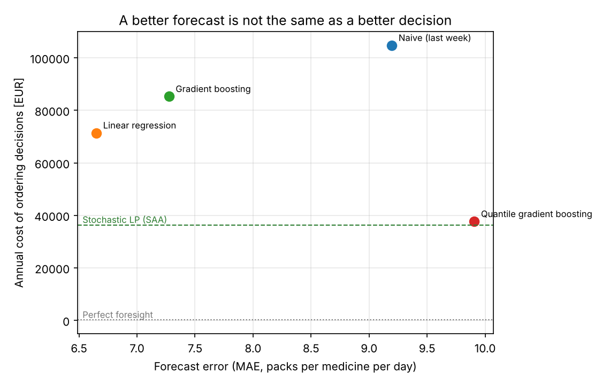
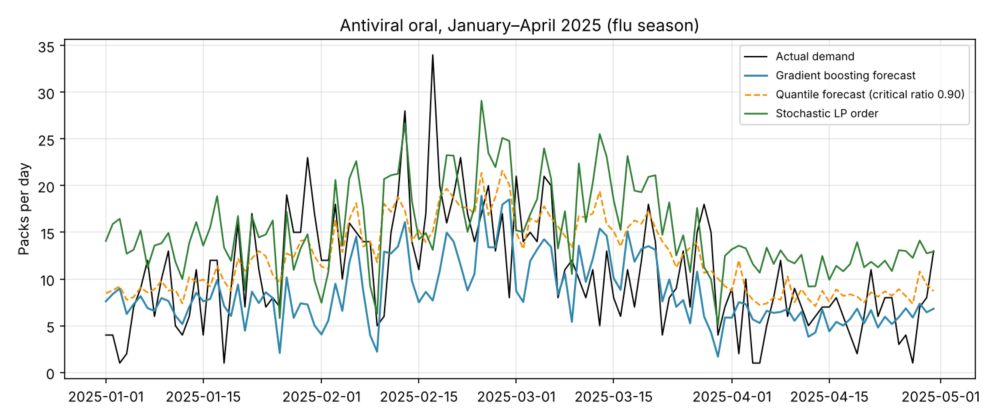
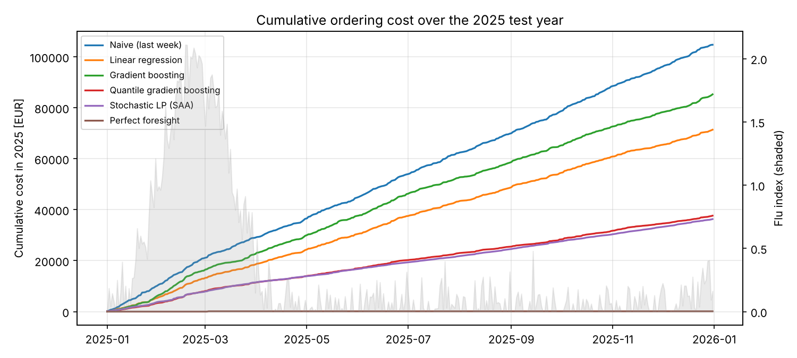

# Predict-then-Optimize – Hospital Medicine Ordering under Uncertainty

## Why I built this

My background is in machine learning, and I always measured forecasts by their
error. I wanted to test whether the most accurate forecast also leads to the best
decision, using hospital medicine orders as an example.

The answer was no. The model with the lowest error led to many shortages, because
running out of a medicine is much more expensive than having a few packs left over.
This project changed how I think about forecasting: the goal is a good decision,
not only a small error.

Does the most accurate demand forecast lead to the best ordering decisions? This project shows that it does not.

A hospital pharmacy restocks a ward cabinet with 6 medicines every evening for the next day. Machine learning
models forecast demand, and the order quantities come either straight from a forecast or from a
**stochastic linear program** that uses the forecast's error distribution and respects the cabinet's limited space.
On a full test year, the stochastic program cuts the cost of left-over and missing medicines by **57%** compared with
ordering on the gradient boosting forecast, and by **49%** compared with the most accurate forecast, even though it
uses the same predictions.



## Problem

- **6 medicines** (IV antibiotic, oral antiviral, IV paracetamol, insulin, heparin, saline), with daily demand depending on the weekday, season, a 4% yearly trend and a regional **flu index** (known with a one-day delay, like public surveillance data). Demand is negative binomial, so it is noisier than a Poisson process.
- **Costs per pack:** a left-over pack costs 0.30–2 EUR (return handling, expiry risk); a missing pack costs 3–25 EUR (emergency delivery). So the target is to cover demand on about 89–94% of days, depending on the medicine.
- **Shared space:** the ward cabinet holds 110 litres, and each medicine takes a different amount of space per pack.
- **Data:** 3 years of synthetic daily data. 2023 is used for training, 2024 for rolling validation, and 2025 as an unseen test year.

## Method

**1. Forecasting (scikit-learn), per medicine.** Features are the weekday, season (sine/cosine), trend, flu index
from yesterday and last week, and recent demand (yesterday, same weekday last week, 7- and 28-day means).
- Naive baseline: same weekday last week
- Linear regression
- Gradient boosting (`HistGradientBoostingRegressor`, squared error)
- Quantile gradient boosting, trained directly at each medicine's critical ratio `p / (p + h)`

**2. Learning the forecast error.** Gradient boosting is refitted at the start of each quarter of 2024 on all
earlier data and predicts the next quarter (rolling-origin validation). The errors are standardized as
`(actual − forecast) / √forecast`, the natural scale for count data, and stored one day per row, so that the
errors of different medicines on the same day stay correlated.

**3. Decisions.** Plug-in rules order the forecast and scale all orders down proportionally if the cabinet overflows.
The **sample average approximation (SAA)** instead turns each day's forecast into 200 demand scenarios using the
stored errors and solves:

```
min  (1/S) Σ_s Σ_i ( h_i · over_is + p_i · under_is )
s.t. over_is  ≥ q_i − d_is              left-over packs of medicine i in scenario s
     under_is ≥ d_is − q_i              missing packs
     Σ_i vol_i · q_i ≤ 110 litres        shared cabinet space
     q, over, under ≥ 0
```

Without the space limit, the optimal order is the `p / (p + h)` quantile of demand (the classic newsvendor
result); with it, the LP decides which medicines get the scarce space. Each daily LP has about 2,400 variables
and is solved with HiGHS via `scipy.optimize.linprog`, so the full year of 365 LPs solves in seconds.

## Results (2025 test year)

| Method | Forecast error (MAE) | Annual cost | Fill rate | Orders covering demand |
|---|---|---|---|---|
| Naive (last week) | 9.20 | 104,734 EUR | 80.4% | 52.3% |
| Linear regression | **6.65** | 71,396 EUR | 86.7% | 56.1% |
| Gradient boosting | 7.28 | 85,277 EUR | 83.8% | 51.3% |
| Quantile gradient boosting | 9.91 | 37,653 EUR | 95.1% | 81.6% |
| **Stochastic LP (SAA)** | (uses gradient boosting) | **36,314 EUR** | **96.9%** | **89.7%** |
| Perfect foresight (bound) | 0 | 128 EUR | 99.9% | – |

Target share of orders covering demand: 91.7% (the average critical ratio).



### Key insights

1. **The most accurate forecast gives poor decisions.** Linear regression has the lowest error, but ordering exactly
   what it predicts runs short on almost every second day. Because a missing pack costs 8–17 times more than a left-over
   one, the right order is *above* the expected demand.
2. **Decision-aware methods halve the cost.** Quantile regression and the stochastic LP both have *higher* forecast
   errors by construction, yet cost 49–57% less than the point forecasts and raise the fill rate from 84% to 95–97%.
3. **The stochastic LP is the best calibrated.** Its orders cover demand on 89.7% of days, close to the 91.7% target.
   Quantile gradient boosting only reaches 81.6%, because its quantiles are learned from limited data. The LP is
   3.6% cheaper overall and has the highest fill rate.
4. **Correct ordering makes space the bottleneck, and the LP allocates it sensibly.** With calibrated orders, the
   cabinet is full on 236 days. Compared with what it would order given unlimited space, the LP then cuts each
   medicine in exact reverse order of its shortage cost per litre: oral antivirals by 2% (90 EUR per litre),
   insulin by 3%, heparin by 4%, IV antibiotics by 8%, IV paracetamol by 12%, and saline by 21% (5 EUR per litre).
   A proportional cut, as in the plug-in rules, would treat them all the same.
5. **Almost all of the cost is uncertainty.** With perfect foresight, the year would cost 128 EUR. The remaining
   36,000 EUR is the price of not knowing tomorrow's demand, and an upper bound on what better forecasting could be worth.



## How to run

```bash
pip install -r requirements.txt
python src/run.py
```

All tables and figures are written to `results/`. The full run takes about 30 seconds.

## Project structure

```
src/data.py       medicines, costs, cabinet size, synthetic demand and features
src/forecast.py   naive, linear, gradient boosting and quantile gradient boosting forecasts
src/optimize.py   capacity scaling for plug-in orders and the stochastic LP (SAA)
src/run.py        rolling validation, test-year forecasts, daily decisions, evaluation and plots
results/          CSV outputs and figures
```

## Limitations and possible extensions

- **No inventory carry-over:** left-over packs are returned each day. A multi-day model with stock levels and expiry
  dates would turn this into a dynamic (multi-stage) problem.
- **End-to-end learning:** train the forecast directly on decision cost ("smart predict-then-optimize") instead of
  forecast error.
- **Robust variant:** replace scenarios with an uncertainty set to protect against flu waves that are stronger than any in the training data.
- **Real data:** hospital dispensing records and RKI influenza surveillance data.
